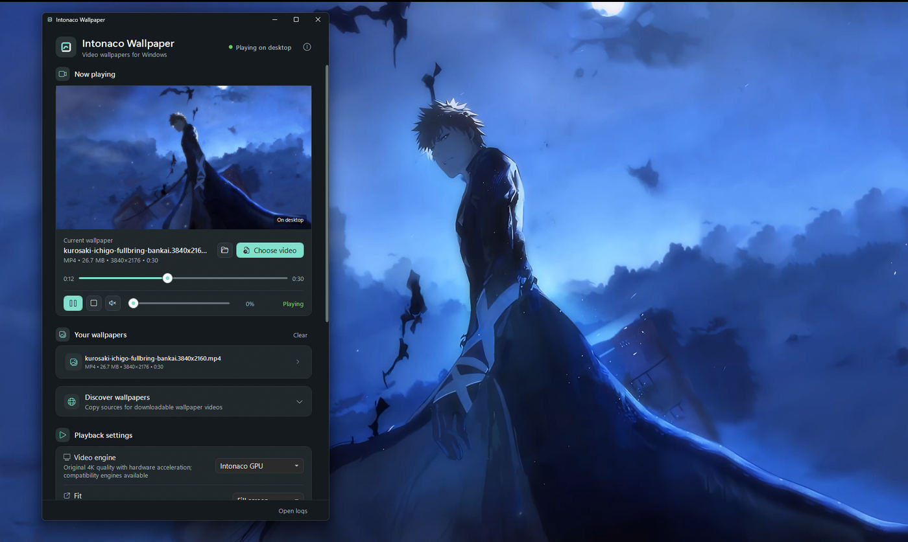
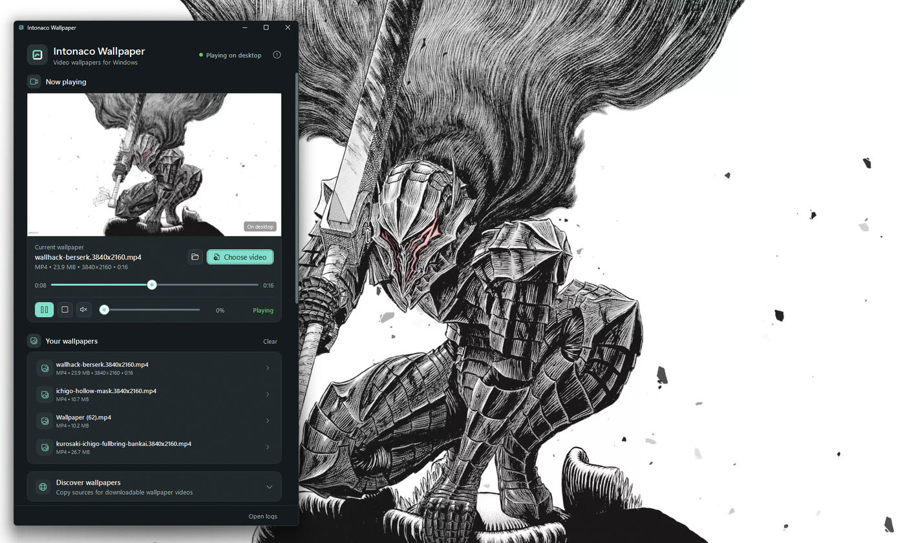

<p align="center">
  
  
</p>

<p align="center">
  <strong>Video wallpapers for Windows 10 and 11.</strong><br>
  Play a local video behind your desktop icons, with straightforward playback controls.
</p>

<p align="center">
  <a href="https://github.com/p4yy/Intonaco/releases/tag/v2.2.0"><strong>Download v2.2.0</strong></a>
  &nbsp;·&nbsp;
  <a href="https://github.com/p4yy/Intonaco/blob/main/docs/PRIVACY.md">Privacy</a>
  &nbsp;·&nbsp;
  <a href="https://github.com/p4yy/Intonaco/issues">Support</a>
</p>

<p align="center">
  <a href="https://github.com/p4yy/Intonaco/actions/workflows/ci.yml"></a>
  <a href="LICENSE"></a>
</p>

## See it in action

<a href="https://cdn.jsdelivr.net/gh/p4yy/Intonaco@v2.2.0/docs/demo/intonaco-demo.mp4">
  
</a>

<sub>Real application recording. [Play the demo with sound](https://cdn.jsdelivr.net/gh/p4yy/Intonaco@v2.2.0/docs/demo/intonaco-demo.mp4) · [View a still screenshot](docs/demo/intonaco-demo-poster.png)</sub>

## Screenshots

| Desktop playback | Wallpaper history |
| :---: | :---: |
|  |  |

<sub>Actual app captures, resized for the web. The sample wallpapers shown are user-selected media and are not bundled with Intonaco.</sub>

## Features

- **Live desktop wallpaper:** Play a supported local video behind Windows desktop icons.
- **Built-in video engine:** Direct3D 11 and Windows Media Foundation playback, with compatibility modes for supported hardware.
- **Playback controls:** Play, pause, seek, loop, speed, fit and volume from a native Windows interface.
- **Resource-aware pause:** Retain the displayed frame while pausing decoder activity in the integrated GPU engine.
- **Wallpaper history:** Quickly reopen recent videos; optionally restore the last wallpaper at sign-in.
- **System integration:** Tray access, fullscreen/focus-aware behavior and recovery after Windows Explorer restarts.

No accounts, wallpaper marketplace, telemetry SDK or required external video player. Videos are selected and played locally. The **Discover wallpapers** section provides copyable links to external websites; it does not download or bundle their content.

## Download

| Windows x64 | File |
| --- | --- |
| **Standard installation** | [Intonaco-Wallpaper-Setup.exe](https://github.com/p4yy/Intonaco/releases/download/v2.2.0/Intonaco-Wallpaper-Setup.exe) |
| **Portable application** | [Intonaco-Wallpaper-Portable.exe](https://github.com/p4yy/Intonaco/releases/download/v2.2.0/Intonaco-Wallpaper-Portable.exe) |
| **Release notes and SHA-256 checksums** | [v2.2.0 release](https://github.com/p4yy/Intonaco/releases/tag/v2.2.0) |

The GitHub EXEs are **unsigned** and Windows SmartScreen may display a warning. Download only from the official release and verify checksums if needed. The `.msixupload` asset is **for Microsoft Partner Center**, not for normal installation.

**Microsoft Store:** Version 2.2.0.0 was submitted for certification on November 13, 2026. Submission is not approval; the Store app is not available until Microsoft completes certification and publishing.

## Compatibility

Intonaco targets **Windows 10 and 11 (x64)**. For broad built-in compatibility, use an **H.264 MP4** video. Other containers and codecs depend on the media components available in Windows and on the graphics driver. Performance and memory use vary with video resolution, codec and hardware.

The app does not currently play animated GIF, WebP or APNG as wallpaper video inputs. Some proprietary `.mlw` files require their original application.

## Build from source

Intonaco is an open-source **.NET 8 / WPF** desktop app with a native Direct3D 11 video backend.

```powershell
git clone https://github.com/p4yy/Intonaco.git
cd Intonaco
dotnet restore Intonaco.sln
dotnet build Intonaco.sln -c Release
dotnet test Intonaco.sln -c Release
```

For Windows build and testing details, see [Verification](docs/VERIFICATION.md), [Store packaging](docs/MICROSOFT_STORE.md) and [Third-party notices](THIRD-PARTY-NOTICES.md).

<sub>Intonaco Wallpaper is developed by Acev Apps Co. · [Privacy policy](docs/PRIVACY.md) · [Issues and support](https://github.com/p4yy/Intonaco/issues)</sub>
